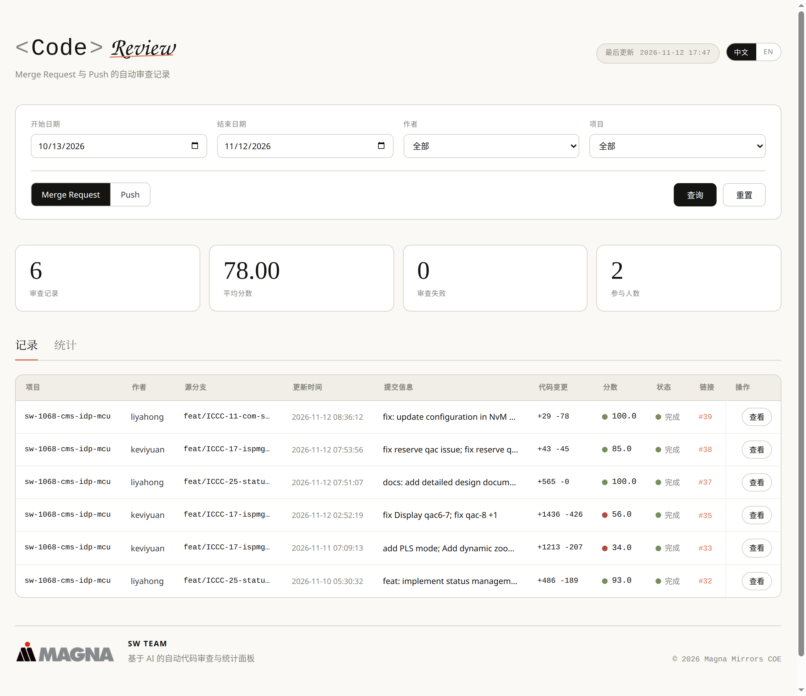
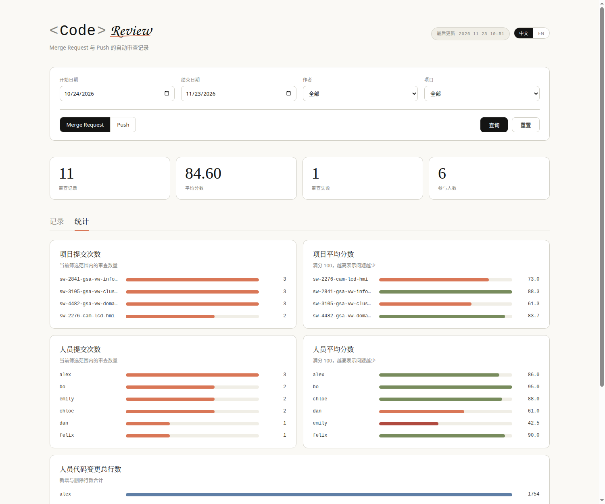
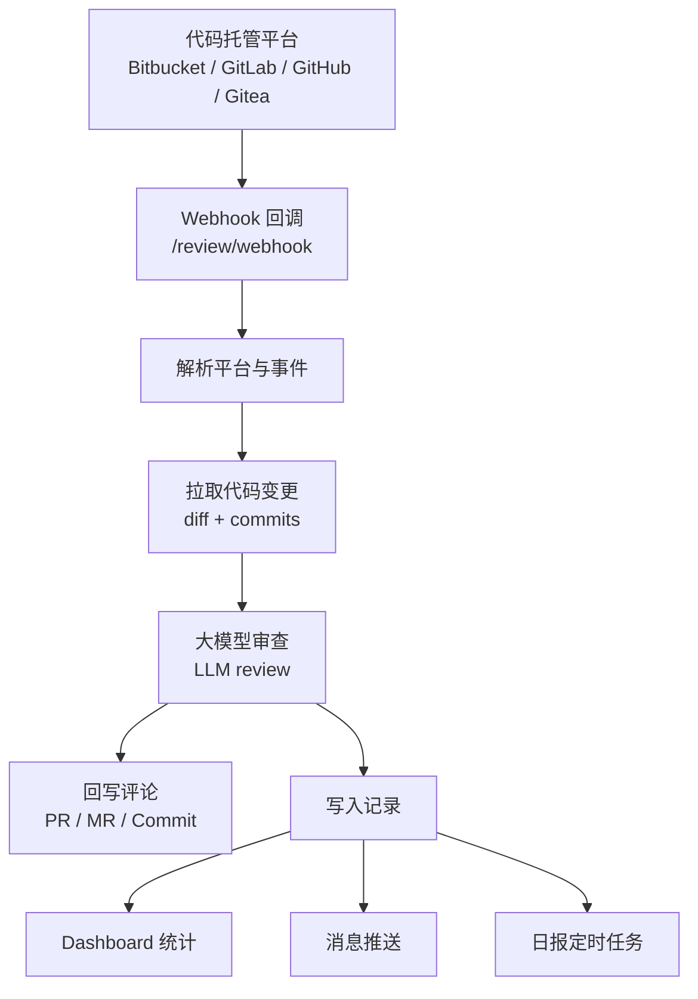

## 项目简介

基于大模型的自动化代码审查工具。代码推送到仓库时自动触发审查，
把结果以评论形式回写到 Pull Request / Merge Request 上，并汇总到 Dashboard。

当前主要支持 **Bitbucket Server / Data Center（自建部署）**，
同时兼容 GitLab、GitHub、Gitea。

## 功能

- **多模型可选**：OpenAI、DeepSeek、通义千问、GitHub Copilot
- **审查结果回写**：以评论形式发到 PR / MR 上，附变更范围与评分
- **统计 Dashboard**：审查记录列表 + 项目/人员维度统计，支持按日期、作者、项目筛选
- **消息推送**：钉钉、企业微信、飞书
- **开发日报**：按提交记录自动汇总每日动态

审查风格通过 `REVIEW_STYLE` 切换：`professional`（严谨）、`concise`（简洁）、
`gentle`（温和）。具体定义见 `src/utils/code_reviewer.py`。

## 界面

下面两张截图用的是 `scripts/generate_demo_data.py` 生成的假数据
（项目名、人名、分支、提交信息全部虚构，不含任何真实信息）。

### 审查记录



### 统计视图



## 工作原理

开发者提交代码时，代码托管平台按 Webhook 配置回调本系统。系统解析变更内容，
调用大模型做静态审查（代码规范、潜在错误、安全风险、可维护性），
完成后把报告作为评论回写到对应页面。



事件驱动的关键点：

- **PR 审查**在 `pr:opened`（PR 创建）和 `pr:from_ref_updated`（源分支更新）时触发
- **`pr:deleted`（PR 被删除）会删除对应的审查记录** —— PR 都没了，记录留着
  只是打不开的死链，还继续占着统计里的提交次数和行数
- **统计口径**：一个 PR 里如果混有别人的 commit，这次的代码行数和评分都不计入
  提 PR 的人名下（平台没提供 per-commit 行数，算不出精确分摊）

## 部署

### 方式一：Docker（推荐）

**1. 准备配置**

```bash
git clone https://github.com/leehyon/auto-code-review
cd auto-code-review
cp config/.env.dist config/.env
```

编辑 `config/.env`。完整变量清单见 [`config/.env.dist`](config/.env.dist)，
必填项：

```bash
# 大模型供应商：openai / deepseek / qwen / github_copilot
LLM_PROVIDER=deepseek
DEEPSEEK_API_KEY={YOUR_DEEPSEEK_API_KEY}

# Bitbucket 实例地址与凭据
BITBUCKET_URL=https://bitbucket.example.com
BITBUCKET_ACCESS_TOKEN={YOUR_BITBUCKET_ACCESS_TOKEN}

# 审查的文件类型（不在列表里的文件不会被审查）
SUPPORTED_EXTENSIONS=.java,.py,.php,.yml,.vue,.go,.c,.cpp,.h,.js,.css,.md,.sql,.ts,.jsx,.tsx,.arxml
```

**2. 启动**

```bash
docker compose up -d
```

**3. 验证**

- API 服务：<http://your-server-ip:5001> ，返回 "The code review server is running."
- Dashboard：<http://your-server-ip:5002>

**改了 `config/.env` 之后**要重建容器才生效（`.env` 通过 compose 的 `env_file`
注入，容器创建时才读）：

| 命令 | 改 `.env` 生效 | 重建镜像 |
| --- | --- | --- |
| `docker compose restart` | 否 | 否 |
| `docker compose up -d` | 是 | 否 |
| `docker compose up -d --build` | 是 | 是 |

`--build` 只在改了 `src/`、`api.py`、`requirements.txt` 时才需要。

### 方式二：本地 Python

```bash
pip install -r requirements.txt      # Python 3.10+
cp config/.env.dist config/.env       # 编辑后
python api.py                         # API 服务，端口 5001
python ui_server.py                   # Dashboard，端口 5002
```

### 方式三：systemd 常驻

用 systemd 托管两个进程（API + Dashboard），支持开机自启和崩溃重启。
完整 unit 文件见 [docs/SYSTEMD_DEPLOY.md](docs/SYSTEMD_DEPLOY.md)。

审查任务默认在 API 进程内 fork 子进程执行（`QUEUE_DRIVER=async`），不需要单独部署 worker。

## 配置 Bitbucket

### Access Token

Bitbucket Data Center 提供两种 HTTP access token，任选其一：

| | 个人 token | 项目 / 仓库级 token |
| --- | --- | --- |
| 创建位置 | 头像 → **Manage account** → **HTTP access tokens** | **Project / Repository settings** → **HTTP access tokens** |
| 绑定对象 | 用户账号 | 项目或仓库，不绑定用户 |
| 创建权限 | 本人 | 需要项目或仓库管理员权限 |
| License | 无额外要求 | 需要 Data Center license |
| 可见范围 | 该用户可访问的所有仓库 | 仅该项目/仓库及下级仓库 |

**本系统统一用 Bearer 认证**（只传 token、不传用户名），个人 token 和项目/仓库级 token
都适用。一套配置覆盖两种 token，也不用在配置里保存用户名。

| Token 类型 | HTTP Basic | Bearer |
| --- | --- | --- |
| 个人 token | 用户名 + token | 仅 token |
| 项目 / 仓库级 token | 用户名必须是 `x-token-auth` | 仅 token（官方唯一要求的方式） |

> 官方原文：*"In Git and API calls, you can use the project and repository level token only with Bearer authentication."*

不选 HTTP Basic 的原因：部分 Atlassian 部署的机器人防护会针对 Basic 认证触发
**CAPTCHA**，令自动化调用中断；Basic 还要把用户名和 token 一起编码传输，
相比 Bearer 并不更安全。

> 官方把 PAT 定位为 *"a safe alternative to using username and password for authentication"*。
> 参考：<https://confluence.atlassian.com/enterprise/using-personal-access-tokens-1026032365.html>

区分自己用的是哪种 token，看创建位置即可（Bitbucket 没有 token 自省接口）。
仓库根目录有诊断脚本，会用互相独立的特征交叉验证：

```bash
python3 check_bitbucket_token.py
```

| 特征 | 个人 token | 项目/仓库级 token |
| --- | --- | --- |
| `GET /projects` 可见项目数 | 该用户有权限的全部项目 | 只有绑定的 1 个 |
| 跨项目访问其它项目 | 200 | 403 / 404 |
| `GET /users` 列出全部用户 | 200 | 403 / 404 |

加 `--probe-basic` 会额外发一个 `Basic x-token-auth` 请求做最直接的判定。

**权限要求**：

| 用途 | 所需权限 |
| --- | --- |
| 读取 PR、diff、commit | Repository **read** |
| 回写 PR 评论 / Commit 评论 | Repository **write**（*Perform pull request actions*） |
| 受保护分支过滤 | Repository **admin** |

### Webhook

项目/仓库设置 → **Repository settings** → **Webhooks** → **Add webhook**：

- URL：`http://your-server-ip:5001/review/webhook`
- Events：勾选 **Pull request**（含 `pr:opened`、`pr:from_ref_updated`、**`pr:deleted`**）与 **Repository** → **Push**
- Secret：建议填写，并与环境变量 `BITBUCKET_WEBHOOK_SECRET` 保持一致

> 个人仓库（personal project）需要在**仓库级别**配 webhook，项目级 webhook 不覆盖个人仓库。

### 环境变量

```bash
# Bitbucket 实例地址（自建部署）
BITBUCKET_URL=https://bitbucket.example.com
# HTTP access token（个人与项目/仓库级通用，只用 Bearer 认证）
BITBUCKET_ACCESS_TOKEN=your_bitbucket_access_token_here
# Webhook Secret，与 Bitbucket webhook 设置里的 Secret 一致，强烈建议配置
BITBUCKET_WEBHOOK_SECRET=your_bitbucket_webhook_secret
# 自建实例用自签证书时，设 0 关闭证书校验
BITBUCKET_VERIFY_SSL=0
# REST API 前缀，默认 /rest/api/1.0
#BITBUCKET_API_PATH=/rest/api/1.0
# 仓库级指令文件。留空 = 自动发现常见约定文件，多个项目不用逐个配
#BITBUCKET_REPO_CONTEXT_FILES=
#BITBUCKET_REPO_CONTEXT_MAX_LINES=200
#BITBUCKET_REPO_CONTEXT_MAX_BYTES=20000
```

### 平台行为说明

- **事件识别**：通过 `X-Event-Key` 请求头识别（`pr:opened`、`pr:from_ref_updated`、
  `pr:deleted`、`repo:refs_changed`），与 GitHub/Gitea 的 Header 不冲突，可同时接入多平台
- **签名校验**：配置 `BITBUCKET_WEBHOOK_SECRET` 后，用 `X-Hub-Signature` 头的
  HMAC-SHA256 校验**原始请求体**，不通过返回 403。校验必须用未经解析的原始字节，
  格式化过的 JSON 对不上。未配置则跳过校验（仅告警）
- **实例地址推导**：未配置 `BITBUCKET_URL` 时，从 payload 里的仓库链接推导（含 context path）。
  个人仓库的链接挂在 `/users/<username>/` 下，同样支持
- **凭证来源**：只用环境变量 `BITBUCKET_ACCESS_TOKEN`，以 `Authorization` 头发送。
  Webhook 上配置的 HTTP Basic 认证头**不会**被解析成凭证
- **个人仓库**：project key 形如 `~用户名`（如 `~LIYAHONG`），大小写不敏感
- **Bitbucket Cloud 不适用**：Cloud（bitbucket.org）使用 REST API 2.0 与不同的
  payload 结构，当前版本不支持

各平台的处理差异（事件命名、API 端点、数据格式）详见
[docs/PLATFORM_COMPARISON.md](docs/PLATFORM_COMPARISON.md)。

### 其他平台

GitLab / GitHub / Gitea 的 Access Token 和 Webhook 配置步骤见
[docs/PLATFORM_SETUP.md](docs/PLATFORM_SETUP.md)。
平台识别方式与 Bitbucket 不同，但配置项结构一致，详见 `config/.env.dist`；
配置不生效、Token 无效等问题见 [docs/faq.md](docs/faq.md)。

## 配置消息推送

### 钉钉

在钉钉群添加自定义机器人拿到 Webhook URL，然后：

```bash
DINGTALK_ENABLED=1
DINGTALK_WEBHOOK_URL=https://oapi.dingtalk.com/robot/send?access_token=xxx
```

企业微信和飞书配置类似，见 [docs/faq.md](docs/faq.md)。

## Dashboard

Dashboard 由 `ui_server.py` 提供，是一个基于 Flask 的轻量级服务：

- **默认端口**：5002（`UI_PORT` 可改）
- **前端**：原生 HTML + CSS + JavaScript，**零外部依赖** —— 页面不引用任何 CDN，
  内网甚至断网环境都能正常打开
- **文件**：`web/index.html`（样式令牌和 UI 结构）、`web/app.js`（数据获取、图表渲染、筛选）

功能：审查记录列表（MR 和 Push 两种类型）、统计图表、多维度筛选（日期、作者、项目）、
中英文界面切换。

> 旧实现 `ui.py`（Streamlit）已废弃，请用 `ui_server.py`。

## 配置说明

完整环境变量清单见 [`config/.env.dist`](config/.env.dist)。下面只列需要理解行为的。

### 大模型供应商

`LLM_PROVIDER` 取 `openai` / `deepseek` / `qwen` / `github_copilot`，
完整列表见 `src/llm/factory.py`。各供应商的密钥与地址变量：

| 模型 | API 密钥 | API 地址 | 模型名称 |
| --- | --- | --- | --- |
| OpenAI | `OPENAI_API_KEY` | `OPENAI_API_BASE_URL` | `OPENAI_API_MODEL` |
| DeepSeek | `DEEPSEEK_API_KEY` | `DEEPSEEK_API_BASE_URL` | `DEEPSEEK_API_MODEL` |
| 通义千问 | `QWEN_API_KEY` | `QWEN_API_BASE_URL` | `QWEN_API_MODEL` |
| GitHub Copilot | `GITHUB_COPILOT_TOKEN` | 自动发现（可覆盖） | `GITHUB_COPILOT_MODEL` |

GitHub Copilot 默认走 Responses API（`POST {base}/responses`，body 用 `input`），
部分模型走 chat/completions 会返回 `unsupported_api_for_model`。
需要切回 chat/completions 时设 `GITHUB_COPILOT_API_MODE=chat_completions`。

Copilot 的 endpoint 因订阅类型而异（business 账号是 `api.business.githubcopilot.com`）。
不显式配置 `GITHUB_COPILOT_API_BASE_URL` 时，系统会通过
`GET https://api.github.com/copilot_internal/user` 自动查到，查不到则用默认地址。
`GITHUB_COPILOT_TOKEN` 可以是 GitHub token（`ghp_` / `gho_` / `github_pat_` 等开头），
系统会先尝试换取短期 Copilot token；部分订阅类型（business）换取时会返回 403，
这时直接用原始 token 当 Bearer 可行，程序会自动回退。

排查用 `python3 check_copilot_token.py` —— 会打印订阅类型、真实 endpoint 和可用模型列表。

### 审查提示词

**位置**：`config/prompt_templates.yml`

分两层：`base_review_prompt` 是全部语言共用的审查方法与输出协议，
`review_profiles` 是各领域（`general` / `python` / `frontend` / `java` / `go` /
`automotive`）的方向提示。程序按本次变更实际涉及的文件扩展名决定用哪几段，
一次调用送进模型。

`user_prompt` 有五个占位符由程序填充：`{project_context}`、`{review_scope}`、
`{profile_checks}`、`{diffs_text}`、`{commits_text}`。

**新增或修改审查方向请改 profile，不要改本文档**，以免两处不一致。

审查报告结构固定：

```text
## Summary
- Overall Risk Level / Total Issues / Blocking Issues / Review Score / Merge Recommendation
## Issues
### [SEVERITY] Title → Severity / Category / Location
  → 🐛 Problem / 🚧 Standard Violation (Rule ID) / 🔍 Evidence / ⚡ Impact / 💡 Recommendation
## Questions / Needs Confirmation   (Optional，存疑项不计入分数)
## Good Practices Observed (Optional)
```

### 文件类型过滤

**位置**：`src/<platform>/webhook_handler.py`

`SUPPORTED_EXTENSIONS` 控制哪些文件类型会被审查（`.arxml` 用于 AUTOSAR ARXML；
`.xml` 不在列表里，因此普通 XML 文件不会被审查）。不在列表里的文件**静默跳过**
（不报错、不发评论）。

新增文件类型时记得同时改 `config/.env` 和 `config/.env.dist`。

### Token 限制与文件优先级

**位置**：`src/utils/code_reviewer.py`

`REVIEW_MAX_TOKENS` 控制送给模型的 diff 文本长度上限（默认 100000）。
超出时按顺序截断，**后面的文件会整份丢失** —— 覆盖度信息里会列出没审到的文件。

截断是按顺序切的，所以**文件顺序决定谁被砍掉**。系统按扩展名分三档，源码优先：

| 优先级 | 类型 | 扩展名 |
| --- | --- | --- |
| 0（最先） | 源码 | `.c` `.h` `.cpp` `.hpp` `.py` `.java` `.go` `.js` `.ts` `.vue` 等 |
| 1 | 其它 | `.md` `.yml` `.css` `.sql` 等 |
| 2（最后） | 生成的模型/配置 | `.arxml` `.xml` |

所以同一个 PR 里改了源码又改了生成的 ARXML，预算不够时先砍 ARXML。
要调整低优先级扩展名设 `REVIEW_LOW_PRIORITY_EXTENSIONS`。

### 审查覆盖度与仓库约定

覆盖度信息会**在送进模型之前**告知模型，并要求它不要对未纳入的文件下结论：

```text
- Files changed in this pull request: 6 (modified 6)
- Lines changed: +511 / -4001
- Files actually reviewed: 2 (+123 / -327 lines)
- Files NOT reviewed because of the token budget: 4
    - DcmConfigurationValues.arxml (modified, +32/-1146)
```

三个要点：

- **删除/重命名/二进制的文件不会被丢弃** —— 模型能知道「这次删了某个文件」
- **没审到的文件不会被当成"已确认正确"**，也不为它们扣分
- **仓库级约定自动发现**：从仓库根目录找 AGENTS.md、CLAUDE.md、CONTRIBUTING.md、
  .github/copilot-instructions.md 等常见约定文件（在被审查的仓库里，不是在本项目里），
  从 PR 的**目标分支**有界读取后作为「项目约定」提供给模型。多个项目不需要逐个配置；
  要指定别的文件设 `BITBUCKET_REPO_CONTEXT_FILES`

### 评论 @ 提醒

**位置**：`src/utils/comment_format.py`

`REVIEW_MENTION_USERS` 指定要 @ 提醒的用户，逗号分隔：

```bash
REVIEW_MENTION_USERS=junchu1,alice
```

各平台的 @ 语法都是正文里的 `@用户名`，同一份配置对所有平台生效。

### 功能开关

- `PUSH_REVIEW_ENABLED`：是否启用 Push 事件审查（默认关闭）
- `MERGE_REVIEW_ONLY_PROTECTED_BRANCHES_ENABLED`：是否仅对受保护分支审查
- `MERGE_REVIEW_ONLY_BRANCH_NAME`：只审查指定的目标分支，逗号分隔

### 专项审查提示词

`src/cmd/functions/` 下还有目录结构、MySQL 表结构、分支策略三个专项审查，
用 `python -m src.cmd.review` 触发。

## 常见问题

见 [docs/faq.md](docs/faq.md)：部署、配置、Webhook、消息推送、统计口径等常见问题。

## 相关文档

- [docs/faq.md](docs/faq.md) —— 常见问题解答
- [docs/PLATFORM_SETUP.md](docs/PLATFORM_SETUP.md) —— GitLab / GitHub / Gitea 的配置步骤
- [docs/PLATFORM_COMPARISON.md](docs/PLATFORM_COMPARISON.md) —— 各平台处理差异对比
- [docs/SYSTEMD_DEPLOY.md](docs/SYSTEMD_DEPLOY.md) —— systemd 常驻部署
- [`config/.env.dist`](config/.env.dist) —— 完整环境变量清单

## 维护脚本

| 脚本 | 用途 |
| --- | --- |
| `scripts/generate_demo_data.py` | 造 Dashboard 演示数据（假数据），产出 README 截图用 |
| `scripts/backfill_author_sole_committer.py` | 回填历史记录的归属标记（PR 含他人 commit 时不计入人员统计） |
| `scripts/backfill_pr_refs.py` | 回填历史记录的 PR id 和仓库 slug（PR 删除时按这两个字段定位记录） |
| `check_bitbucket_token.py` | 诊断 Bitbucket token 类型（个人 / 项目级） |
| `check_copilot_token.py` | 诊断 GitHub Copilot token、订阅类型和可用模型 |
