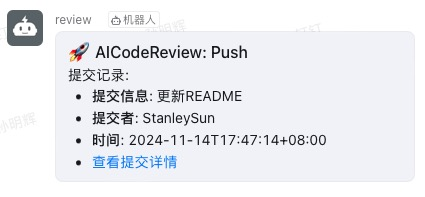
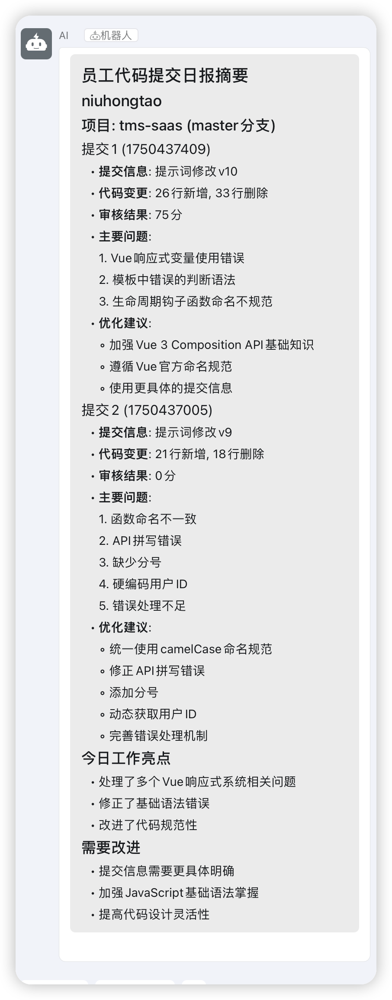
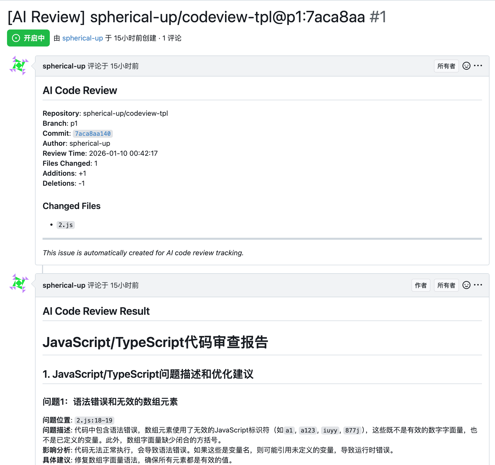
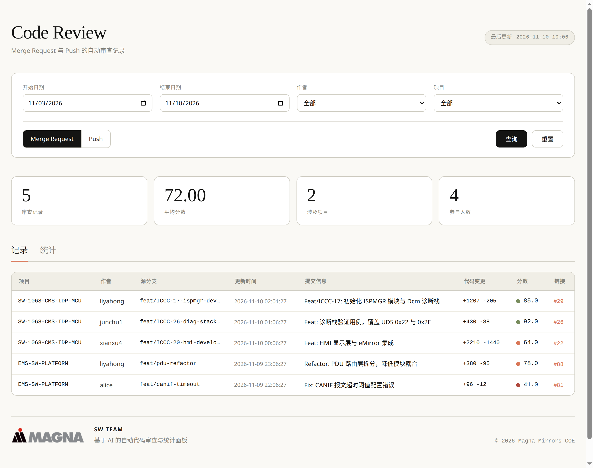
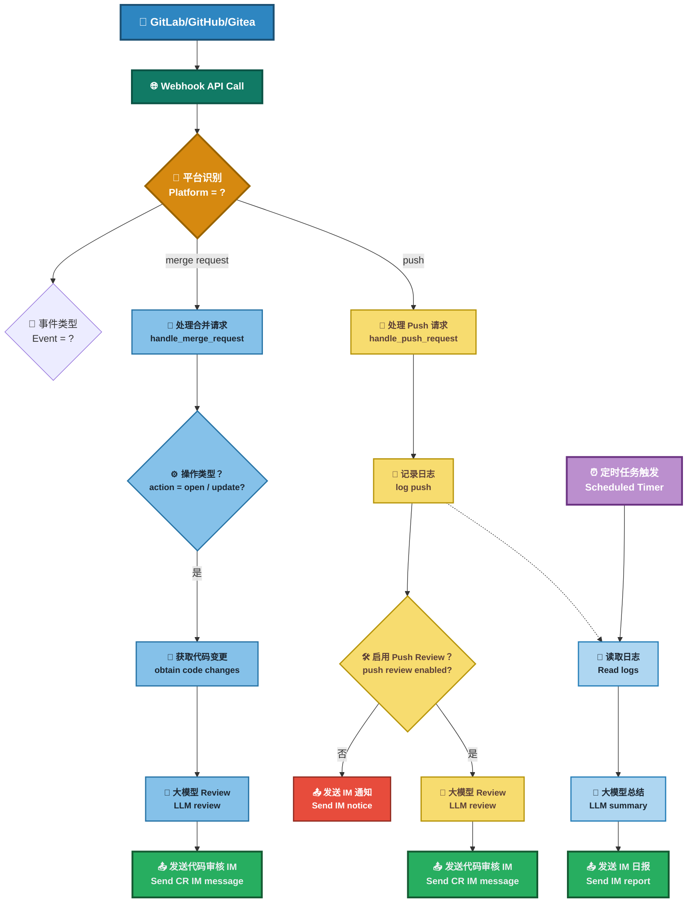

## 项目简介

本项目是一个基于大模型的自动化代码审查工具，帮助开发团队在代码合并或提交时，快速进行智能化的审查，提升代码质量和开发效率。

## 功能

- 🚀 多模型灵活切换
  - 全面兼容 **DeepSeek、OpenAI、通义千问、GitHub Copilot** 想用哪个，用哪个！轻松上手，自由切换。
- 📢 消息实时送达
  - 审查结果 **一键推送** 到 **钉钉、企业微信、飞书**  及时响应，代码问题无所遁形！
- 📅 自动生成开发日报
  - 基于 **GitHub / GitLab / Gitea / Bitbucket Commit** 记录，自动梳理每日开发动态：  
谁在认真敲代码，谁在划水，一清二楚 😼。
- 🔗 多平台支持
  - 全面支持 **GitLab、GitHub、Gitea、Bitbucket Server/Data Center** 四大主流代码托管平台，一套系统，多平台通用！
- 📊 数据可视化 Dashboard
  - 集中展示所有 **Code Review 记录**，提供清晰的：
    - 项目整体统计  
    - 成员贡献分析  
  - 数据说话，甩锅无门！
- 🎭 多种审查风格，任你挑！
  | 风格 | 描述 | 示例 |
  |------|------|------|
  | 🤵 **专业型** | 严谨细致、正式专业 | *建议优化此函数的命名，以提升可读性。* |
  | 😈 **毒舌型** | 毒舌吐槽、直击要害 | *你确定这是人能读的代码？* |
  | 🌸 **绅士型** | 温柔委婉、如沐春风 | *或许这里可以再优化一下呢~* |
  | 🤪 **幽默型** | 搞笑风趣、快乐改码 | *这段 if-else 比我相亲经历还复杂！* |


## 效果图

### Push 推送示例



### 代码审查摘要



### 评论示例



### Dashboard 数据看板



## 原理

在开发者向 **GitLab / GitHub / Gitea / Bitbucket** 提交代码（包括 Merge Request/Pull Request 创建或 Push 操作）时，代码托管平台会根据预设的 Webhook 配置触发回调请求，调用本系统提供的接口。系统接收到事件后，将解析提交内容，并通过集成的第三方大语言模型对代码变更进行静态审查。

审查内容包括但不限于：代码规范检查、潜在错误识别、安全风险分析及可维护性建议。完成审查后，系统会将结果以评论的形式自动回写至对应的 Merge Request/Pull Request 或 Commit 页面（Gitea 还支持创建 Issue 来存储审查结果），确保审查反馈能够实时集成至开发工作流中，从而提升代码质量与团队协作效率。

**流程图**


## 部署

### 方案一：Docker 部署

**1. 准备环境文件**

- 克隆项目仓库：
```aiignore
git clone https://github.com/spherical-up/Easy-AI-CodeReview
cd Easy-AI-CodeReview
```

- 创建配置文件：
```aiignore
cp config/.env.dist config/.env
```

- 编辑 config/.env 文件，配置以下关键参数：

```bash
#大模型供应商配置,支持 openai , deepseek 和 qwen
LLM_PROVIDER=deepseek

#DeepSeek
DEEPSEEK_API_KEY={YOUR_DEEPSEEK_API_KEY}

#支持review的文件类型(未配置的文件类型不会被审查)
SUPPORTED_EXTENSIONS=.java,.py,.php,.yml,.vue,.go,.c,.cpp,.h,.js,.css,.md,.sql,.ts,.jsx,.tsx,.arxml

#钉钉消息推送: 0不发送钉钉消息,1发送钉钉消息
DINGTALK_ENABLED=0
DINGTALK_WEBHOOK_URL={YOUR_WDINGTALK_WEBHOOK_URL}

#Gitlab配置
GITLAB_ACCESS_TOKEN={YOUR_GITLAB_ACCESS_TOKEN}
```

#### GitHub Copilot

用 GitHub Copilot 作为大模型供应商：

```bash
# 大模型供应商配置
LLM_PROVIDER=github_copilot

# GitHub Copilot 配置
GITHUB_COPILOT_TOKEN=your_github_token_here
GITHUB_COPILOT_MODEL=gpt-6-luna
# API 形态：responses（默认）或 chat_completions
GITHUB_COPILOT_API_MODE=responses
# 可选。不配的话会自动向 GitHub 查询该订阅对应的 endpoint
#GITHUB_COPILOT_API_BASE_URL=https://api.githubcopilot.com
```

说明：

- **API 形态**：默认走 **Responses API**（`POST {base}/responses`，body 用 `input`）。
  部分模型（如 `gpt-6-luna`）**只支持 Responses API**，走 chat/completions 会返回
  `unsupported_api_for_model`。需要切回 chat/completions 时设
  `GITHUB_COPILOT_API_MODE=chat_completions`。
- **token**：`GITHUB_COPILOT_TOKEN` 可以是 GitHub token（`ghp_` / `gho_` / `github_pat_` 等开头）。
  系统会先尝试向 GitHub 换取短期 Copilot token；**实测部分订阅类型（business）换 token 会返回 403**，
  这时直接用原始 token 当 Bearer 是可行的，程序会自动回退，不需要额外配置。
- **endpoint**：不同订阅类型域名不同（business 账号是 `api.business.githubcopilot.com`）。
  不显式配置 `GITHUB_COPILOT_API_BASE_URL` 时，会通过
  `GET https://api.github.com/copilot_internal/user` 自动查到，查不到则用默认地址。
- 请求会带上 `Editor-Version`、`Copilot-Integration-Id`、`User-Agent`、`OpenAI-Intent` 四个头。
- 排查用：`python3 check_copilot_token.py` —— 会打印订阅类型、真实 endpoint、可用模型列表，
  并发一次真实请求验证。

**2. 启动服务**

```bash
docker-compose up -d
```

**3. 验证部署**

- 主服务验证：
  - 访问 http://your-server-ip:5001
  - 显示 "The code review server is running." 说明服务启动成功。
- Dashboard 验证：
  - 访问 http://your-server-ip:5002
  - 看到一个审查日志页面，说明 Dashboard 启动成功。

**4. 改了 `config/.env` 之后**

`config/.env` 通过 compose 的 `env_file` 注入，**容器创建时**才生效，所以：

```bash
docker compose up -d     # 改 .env 后用这个，会重建容器
```

| 命令 | 改 `.env` 是否生效 | 会重建镜像吗 |
| --- | --- | --- |
| `docker compose restart` | ❌ 不生效（容器还是旧的） | 否 |
| `docker compose up -d` | ✅ 生效（重建容器） | 否 |
| `docker compose up -d --build` | ✅ 生效 | 是，代码或依赖变了才需要 |

`--build` 只在改了 `src/`、`api.py`、`requirements.txt` 时才需要 —— 改 `.env` 不用重建镜像，
省下几分钟。

> 本地部署（方案二）同理：改完 `.env` 要重启进程才生效。

### 方案二：本地 Python 环境部署

**1. 获取源码**

```bash
git clone https://github.com/spherical-up/Easy-AI-CodeReview
cd Easy-AI-CodeReview
```

**2. 安装依赖**

使用 Python 环境（建议使用虚拟环境 venv）安装项目依赖(Python 版本：3.10+):

```bash
pip install -r requirements.txt
```

**3. 配置环境变量**

同 Docker 部署方案中的.env 文件配置。

**4. 启动服务**

- 启动 API 服务：

```bash
python api.py
```

- 启动 Dashboard 服务：

```bash
python ui_server.py
```

**注意**：Dashboard 前端已从 Streamlit 迁移到基于 HTML + CSS + JavaScript 的实现，前端文件位于 `web/` 目录中。`ui.py` 已废弃，请使用 `ui_server.py` 启动新的前端服务。

### 方案三：systemd 常驻运行

上面的 `python api.py` 跑在终端里，关掉终端就停了。要让它在后台常驻、开机自启、
崩溃自动重启，用 systemd 托管。

需要两个进程：

| 进程 | 命令 | 端口 | 作用 |
| --- | --- | --- | --- |
| API 服务 | `python api.py` | 5001 | 接收 Webhook、触发审查、跑日报定时任务 |
| Dashboard | `python ui_server.py` | 5002 | 前端看板 |

审查任务**不需要单独的 worker**（默认 `QUEUE_DRIVER=async`，在 API 进程里 fork 子进程执行）。

核心的 unit 文件（完整版见 [docs/SYSTEMD_DEPLOY.md](docs/SYSTEMD_DEPLOY.md)）：

```ini
# /etc/systemd/system/ai-code-review-api.service
[Unit]
Description=Easy AI CodeReview - API 服务
After=network-online.target
Wants=network-online.target

[Service]
Type=simple
User=ai-review
Group=ai-review
# 必须指向仓库根目录：config/.env、logs/、data/ 都是相对路径
WorkingDirectory=/opt/ai-code-review
Environment=PYTHONUNBUFFERED=1
Environment=SERVER_PORT=5001
ExecStart=/opt/ai-code-review/venv/bin/python api.py
Restart=always
RestartSec=10
# 停止时把 fork 出去的审查子进程一起收掉
KillMode=control-group
StandardOutput=journal
StandardError=journal

[Install]
WantedBy=multi-user.target
```

Dashboard 同理，把 `ExecStart` 换成 `ui_server.py`、`Environment` 换成 `UI_PORT=5002`。

装好：

```bash
sudo systemctl daemon-reload
sudo systemctl enable --now ai-code-review-api ai-code-review-ui
systemctl status ai-code-review-api
journalctl -u ai-code-review-api -f
```

> **改完 `config/.env` 要 `systemctl restart` 才生效。**

### 配置 Webhook

#### GitLab Webhook 配置

**1. 创建 Access Token**

方法一：在 GitLab 个人设置中，创建一个 Personal Access Token。

方法二：在 GitLab 项目设置中，创建 Project Access Token

**2. 配置 Webhook**

在 GitLab 项目设置中，配置 Webhook：

- URL：http://your-server-ip:5001/review/webhook
- Trigger Events：勾选 Push Events 和 Merge Request Events (不要勾选其它 Event)
- Secret Token：上面配置的 Access Token(可选)

**备注**

1. Token 使用优先级
  - 系统优先使用 .env 文件中的 `GITLAB_ACCESS_TOKEN`。
  - 如果 .env 文件中没有配置 `GITLAB_ACCESS_TOKEN`，则使用 Webhook 传递的 Secret Token。
2. 网络访问要求
  - 请确保 GitLab 能够访问本系统。
  - 若内网环境受限，建议将系统部署在外网服务器上。

#### GitHub Webhook 配置

**1. 创建 Access Token**

在 GitHub 个人设置中，创建一个 Personal Access Token，需要 `repo` 权限。

**2. 配置 Webhook**

在 GitHub 项目设置中，进入 Settings → Webhooks → Add webhook：

- URL：http://your-server-ip:5001/review/webhook
- Content type：选择 `application/json`
- Events：选择 `Just the push event` 和 `Pull requests`（或选择 `Send me everything`）
- Secret：可选，用于签名验证

**3. 环境变量配置**

在 `.env` 文件中配置：

```bash
GITHUB_ACCESS_TOKEN=your_github_access_token_here
GITHUB_URL=https://api.github.com
```

#### Gitea Webhook 配置

**1. 创建 Access Token**

在 Gitea 个人设置中，创建一个 Access Token，需要 `repo` 权限。

**2. 配置 Webhook**

在 Gitea 项目设置中，进入 Settings → Webhooks → Add Webhook：

- URL：http://your-server-ip:5001/review/webhook
- Content Type：选择 `application/json`
- Events：勾选 `Push` 和 `Pull Request`（或选择 `Send Everything`）
- Secret：可选，用于签名验证

**3. 环境变量配置**

在 `.env` 文件中配置：

```bash
GITEA_ACCESS_TOKEN=your_gitea_access_token_here
GITEA_URL=https://your-gitea-instance.com

# Gitea Issue 模式配置（可选）
# 是否使用 Issue 模式存储审核结果（1=启用，0=禁用，默认启用）
GITEA_USE_ISSUE_MODE=1

# Issue 标签（可选，需要先在 Gitea 中创建标签）
# GITEA_REVIEW_ISSUE_LABELS=ai-review,code-review
```

**Gitea 特殊说明**

- Gitea 支持两种审查结果存储方式：
  1. **PR/Comment 模式**：直接在 Pull Request 或 Commit 上添加评论（如果 API 支持）
  2. **Issue 模式**：创建或使用现有 Issue 来存储审查结果（推荐，更稳定可靠）
- Issue 模式的优势：
  - 可审计、可追踪、可统计
  - 支持工单化管理
  - 不依赖 Commit Comments API（某些 Gitea 版本可能不支持）

#### Bitbucket Server/Data Center Webhook 配置

> 本系统支持 **Bitbucket Server / Data Center（自建部署）**，使用 REST API 1.0 接口。

**1. 创建 Access Token**

Bitbucket Data Center 提供**两种** HTTP access token，任选其一即可：

| | 个人 HTTP access token | 项目 / 仓库级 HTTP access token |
|---|---|---|
| 创建位置 | 头像 → **Manage account** → **HTTP access tokens** | **Project / Repository settings** → **HTTP access tokens** |
| 绑定对象 | 某个用户账号 | 某个项目或仓库，**不绑定用户** |
| 创建权限 | 本人 | 需要项目或仓库管理员权限 |
| License | 无额外要求 | **需要 Data Center license** |
| 可见范围 | 该用户可访问的所有仓库 | 仅该项目/仓库及其下级仓库 |
| 可授予项目级权限 | 可以 | 可以（但**仓库级 token 不能**给项目级权限） |

两种 token 在 REST API 上都能用 **Bearer** 认证，这是最容易踩的坑：

| Token 类型 | HTTP Basic | Bearer |
|---|---|---|
| 个人 token | ✅ 用户名 + token | ✅ 仅 token |
| 项目 / 仓库级 token | ⚠️ 用户名**必须**是 `x-token-auth` | ✅ 仅 token（官方唯一要求的方式） |

> 官方原文：*"In Git and API calls, you can use the project and repository level token only with Bearer authentication."*

**本系统统一使用 Bearer 认证（只传 token、不传用户名），不使用 HTTP Basic。**

理由：

- Bearer 对个人 token 和项目/仓库级 token **都适用**，一套配置覆盖两种 token。
- HTTP Basic 需要把用户名和 token 一起编码传输，相比 Bearer 并不更安全。
- 部分 Atlassian 部署的机器人防护会针对 Basic 认证触发 **CAPTCHA**，令自动化调用中断。
- 不需要用户名，也就不需要在配置里保存用户名。

> 官方把 PAT 定位为 *"a safe alternative to using username and password for authentication"*。
> 参考：https://confluence.atlassian.com/enterprise/using-personal-access-tokens-1026032365.html

**如何确认自己填的是哪种 token？**

最权威的办法是**看创建位置**：头像 → Manage account 是个人 token；
Project / Repository settings 是项目/仓库级 token。

Bitbucket 的 REST API 没有 token 自省接口（`/users/{name}/tokens` 返回 404），
所以也可以用行为指纹判定 —— 仓库根目录提供了诊断脚本：

```bash
python3 check_bitbucket_token.py
```

它会用互相独立的特征交叉验证（默认只发 Bearer 请求）：

| 特征 | 个人 token | 项目/仓库级 token |
|---|---|---|
| `GET /projects` 可见项目数 | 该用户有权限的全部项目 | 只有绑定的 1 个 |
| 跨项目访问其它项目 | 200 | 403 / 404 |
| `GET /users` 列出全部用户 | 200 | 403 / 404 |

加 `--probe-basic` 参数会额外发一个 `Basic x-token-auth` 请求做最直接的判定
（`x-token-auth` 能过 = 项目/仓库级 token，401 = 个人 token）。

**本系统需要的权限：**

| 用途 | 所需权限 |
|---|---|
| 读取 PR、diff、commit | Repository **read** |
| 回写 PR 评论 / Commit 评论 | Repository **write**（对应 *"Perform pull request actions"*） |
| 开启受保护分支过滤（`MERGE_REVIEW_ONLY_PROTECTED_BRANCHES_ENABLED=1`） | Repository **admin**（分支限制接口要求 REPO_ADMIN，否则返回 401） |

**2. 配置 Webhook**

在 Bitbucket 项目/仓库设置中，进入 **Repository settings** → **Webhooks** → **Add webhook**：

- URL：http://your-server-ip:5001/review/webhook
- Events：勾选 **Pull request** 与 **Repository**（选择 **Push**）
- Secret：**建议填写**，并把同样的值配到环境变量 `BITBUCKET_WEBHOOK_SECRET`

> 个人仓库（personal project）需要在**仓库级别**配 webhook，项目级 webhook 不会覆盖个人仓库。

**3. 环境变量配置**

在 `.env` 文件中配置：

```bash
# Bitbucket 实例地址（自建部署），例如 https://bitbucket.example.com
BITBUCKET_URL=https://bitbucket.example.com
# HTTP access token（个人 token 与项目/仓库级 token 通用，无需区分）
# 只用 Bearer 认证，不需要用户名
BITBUCKET_ACCESS_TOKEN=your_bitbucket_access_token_here
# Webhook Secret（与 Bitbucket webhook 设置里的 Secret 保持一致），强烈建议配置
BITBUCKET_WEBHOOK_SECRET=your_bitbucket_webhook_secret
# 自建实例使用自签证书时，保持 0 关闭证书校验
BITBUCKET_VERIFY_SSL=0
# 仓库级指令文件。默认留空 = 自动从仓库根目录发现常见约定文件，多个项目不用逐个配。
BITBUCKET_REPO_CONTEXT_FILES=
BITBUCKET_REPO_CONTEXT_MAX_LINES=200
BITBUCKET_REPO_CONTEXT_MAX_BYTES=20000
```

**Bitbucket 特殊说明**：

- **事件识别**：Bitbucket 通过 `X-Event-Key` 请求头传递事件类型（`pr:opened`、`pr:from_ref_updated`、`repo:refs_changed` 等），与 GitHub/Gitea 的 Header 不冲突，系统可同时接入多个平台。
- **触发时机**：仅在 `pr:opened`（PR 创建）和 `pr:from_ref_updated`（源分支更新）时进行 PR 审查；`pr:merged`、`pr:comment:added` 等事件自动忽略。
- **实例地址推导**：未配置 `BITBUCKET_URL` 时，系统会尝试从 webhook payload 中的仓库链接自动推导（含 context path）。个人仓库的链接挂在 `/users/<username>/` 下，系统同样支持。
- **凭证来源**：只使用环境变量 `BITBUCKET_ACCESS_TOKEN`，以 `Authorization` Header 发送（Bearer 认证）。Webhook 上配置的 HTTP Basic 认证头**不会**被解析成凭证。
- **签名校验**：配置 `BITBUCKET_WEBHOOK_SECRET` 后，系统会用 `X-Hub-Signature` 头的 HMAC-SHA256 校验**原始请求体**；校验不通过返回 **403**。校验必须用未经解析的原始字节，格式化过的 JSON 对不上。未配置该变量则跳过校验（仅告警）。
- **受保护分支**：通过 Bitbucket 的分支限制（branch restrictions）接口判断，需要账号具备仓库管理员权限。
- **个人仓库**：project key 形如 `~用户名`（如 `~LIYAHONG`），大小写不敏感，系统会自动处理。
- **Bitbucket Cloud 不适用**：Bitbucket Cloud（bitbucket.org）使用 REST API 2.0 与不同的 payload 结构，当前版本不支持。

### 配置消息推送

#### 1.配置钉钉推送

- 在钉钉群中添加一个自定义机器人，获取 Webhook URL。
- 更新 .env 中的配置：
  ```
  #钉钉配置
  DINGTALK_ENABLED=1  #0不发送钉钉消息，1发送钉钉消息
  DINGTALK_WEBHOOK_URL=https://oapi.dingtalk.com/robot/send?access_token=xxx #替换为你的Webhook URL
  ```

企业微信和飞书推送配置类似，具体参见 [常见问题](docs/FAQ.md)

## 前端 Dashboard 说明

### Web 目录结构

项目的前端 Dashboard 实现位于 `web/` 目录中：

- **技术栈**：原生 HTML + CSS + JavaScript（ES6+），**零外部依赖**
- **文件结构**：
  - `web/index.html` - 主页面，包含设计令牌、组件样式和完整 UI 结构
  - `web/app.js` - 前端逻辑，包括数据获取、条形图渲染、筛选等功能

**零外部依赖**：页面不引用任何 CDN（Tailwind、Chart.js 等一律不用）。
样式令牌和图表渲染都写在仓库里，所以内网、公司网络、甚至断网环境下 Dashboard 都能正常打开。
以前依赖 `cdn.tailwindcss.com`，一旦 CDN 被墙，页面会退化成没有样式的裸 HTML。

### 前端服务

Dashboard 由 `ui_server.py` 提供，这是一个基于 Flask 的轻量级服务：

- **默认端口**：5002（可通过 `UI_PORT` 环境变量配置）
- **访问地址**：http://your-server-ip:5002
- **功能特性**：
  - 数据表格展示（支持 Merge Request 和 Push 两种类型）
  - 统计图表可视化（项目统计、人员统计等）
  - 多维度筛选（日期范围、用户名、项目名）
  - 实时数据更新

### 新旧前端对比

- **旧实现**（已废弃）：`ui.py` - 基于 Streamlit 的实现
- **新实现**（当前使用）：`web/` 目录 + `ui_server.py` - 基于 HTML/CSS/JS 的现代化实现

新实现的优势：
- 更轻量级，无需 Streamlit 依赖
- 零外部依赖，内网 / 断网也能正常打开
- 更快的加载速度（没有 CDN 请求）
- 更容易自定义和扩展（样式令牌集中在 `web/index.html` 顶部的 `:root`）

## 配置说明

### 大模型供应商配置

项目支持多种大模型供应商，通过 `LLM_PROVIDER` 环境变量配置（`openai` / `deepseek` /
`qwen` / `github_copilot`）。支持的完整列表见 `src/llm/factory.py`。

**位置**: `src/llm/factory.py`

### 各模型 API 配置

**位置**: `src/llm/client/` 目录下的各客户端文件

| 模型 | API 密钥 | API 地址 | 模型名称 |
|------|---------|---------|----------|
| **OpenAI** | `OPENAI_API_KEY` | `OPENAI_API_BASE_URL` | `OPENAI_API_MODEL` |
| **DeepSeek** | `DEEPSEEK_API_KEY` | `DEEPSEEK_API_BASE_URL` | `DEEPSEEK_API_MODEL` |
| **通义千问** | `QWEN_API_KEY` | `QWEN_API_BASE_URL` | `QWEN_API_MODEL` |
| **GitHub Copilot** | `GITHUB_COPILOT_TOKEN` | 自动发现（可覆盖） | `GITHUB_COPILOT_MODEL` |

### 代码审查提示词模板

**位置**: `config/prompt_templates.yml`

分两层，避免每加一种语言就抄一遍输出格式：

```yaml
base_review_prompt:      # 审查方法 + 输出协议（全部语言共用，全英文，约 140 行）
  system_prompt: |-      # Rules / Severity / Score / Output Format
  user_prompt: |-       # 五个槽位，由程序填充

review_profiles:         # 每个领域一段方向提示，不是检查项清单
  general:
  python:
  frontend:              # JS / TS / Vue
  java:
  go:
  automotive:            # C / C++ / ARXML
```

`user_prompt` 的五个槽位，程序负责填，模板里只放占位符：

| 槽位 | 内容 |
| --- | --- |
| `{project_context}` | 仓库根目录自动发现的约定文件（AGENTS.md 等） |
| `{review_scope}` | 本次实际审查了哪些文件、哪些没审 |
| `{profile_checks}` | 按领域汇总的方向提示 |
| `{diffs_text}` | 变更内容 |
| `{commits_text}` | 提交信息 |

**profile 是方向段，不是穷举的检查项清单。** 每段给的是关注方向，由模型自己按语言和领域
做工程判断；没有证据就不报。这样避免了「每条检查都像在要求被命中」而诱导模型凑问题。

```
automotive:
  This review may contain C, C++ and AUTOSAR ARXML files.
  Apply language- and domain-appropriate engineering judgment to each file.
  Pay particular attention to:
  - C/C++ correctness, undefined behavior, lifetime, concurrency, ...
  - AUTOSAR model consistency, including port direction, interfaces, ...
  - Cross-file consistency between ARXML definitions and C/C++ usage.
```

程序按本次变更**实际涉及的语言**决定用哪几段方向 —— 逐文件按扩展名判定，
所以同时改了 arxml + C + C++ 的 PR 会拿到 automotive 段，改了 Vue 会拿到 frontend 段，
两者都有就两段都给。同一段不会重复出现。

审查报告的结构固定为：

```
## Summary
- Overall Risk Level / Total Issues / Blocking Issues / Review Score / Merge Recommendation
## Issues
### [SEVERITY] Title → Severity / Category / Location
  → 🐛 Problem / 🚧 Standard Violation (Rule ID) / 🔍 Evidence / ⚡ Impact / 💡 Recommendation
## Questions / Needs Confirmation   (Optional，存疑项不计入分数)
## Good Practices Observed (Optional)
```

> `base` 的 Summary 里必须要求输出 `Review Score: <0-100>`，评分靠正则从报告里提取；
> `user_prompt` 里必须保留上面五个占位符。

### 审查风格配置

**位置**: `src/utils/code_reviewer.py`

通过 `REVIEW_STYLE` 环境变量控制审查风格：

- **`professional`**: 专业严谨风格 - 使用标准的工程术语，保持专业严谨
- **`concise`**: 简洁风格 - 句子短、直给，省掉非必要说明
- **`gentle`**: 温和建议风格 - 多用"建议"、"可以考虑"等温和措辞

### 评论 @ 提醒配置

**位置**: `src/utils/comment_format.py`

通过 `REVIEW_MENTION_USERS` 指定在 PR / Commit 评论里要 @ 提醒的用户，逗号分隔：

```bash
REVIEW_MENTION_USERS=junchu1,alice
```

评论首行的形态：

| 配置 | 首行 |
| --- | --- |
| `junchu1,alice` | `Auto Review Result, @junchu1 @alice FYI:` |
| 留空 | `Auto Review Result:` |

> 留空表示不添加任何 @ 提醒。各平台的 @ 语法都是正文里的 `@用户名`，所以同一份配置
> 对 Bitbucket / GitHub / GitLab / Gitea 都生效。

评论的完整形态（提醒行 → 文件 scope → 模型报告）：

```text
Auto Review Result, @junchu1 @alice FYI:
- Files Changed: 4
- Additions: +460
- Deletions: -1935
- Reviewed: 2 of 4 files (budget-limited)
- Skipped: DcmConfigurationValues.arxml, RteConfigurationValues.arxml
## Summary
- Overall Risk Level: HIGH
...
```

### 文件类型过滤配置

**位置**: `src/<platform>/webhook_handler.py`

通过 `SUPPORTED_EXTENSIONS` 环境变量控制哪些文件类型会被审查（`.arxml` 用于 AUTOSAR
ARXML 配置；`.xml` 不在列表里，因此普通 XML 文件不会被审查）：

```bash
SUPPORTED_EXTENSIONS=.java,.py,.php,.yml,.vue,.go,.c,.cpp,.h,.js,.css,.md,.sql,.ts,.jsx,.tsx,.arxml
```

> 扩展名不在列表里的文件会被**静默跳过**（不报错、不发评论）。新增文件类型时记得
> 同时改 `config/.env` 和 `config/.env.dist`。

### Token 限制配置

**位置**: `src/utils/code_reviewer.py`

`REVIEW_MAX_TOKENS` 控制发送给大模型的 diff 文本长度上限（默认 100000）。
超出时按顺序截断，**后面的文件会整份丢失** —— 覆盖度信息里会列出没审到的文件。

#### 文件审查优先级

截断是按顺序切的，所以**文件顺序决定谁被砍掉**。系统按扩展名分三档，源码优先：

| 优先级 | 文件类型 | 扩展名 |
| --- | --- | --- |
| 0（最先） | 源码 | `.c` `.h` `.cpp` `.hpp` `.py` `.java` `.go` `.js` `.ts` `.vue` 等 |
| 1 | 其它 | `.md` `.yml` `.css` `.sql` 等 |
| 2（最后） | 生成的模型/配置 | `.arxml` `.xml` |

所以同一个 PR 里改了源码又改了生成的 ARXML，预算不够时先砍 ARXML，源码尽量完整进模型。

哪些扩展名算「生成类」可以按项目调整：

```bash
REVIEW_LOW_PRIORITY_EXTENSIONS=.arxml,.xml
```

留空表示没有低优先级文件，全部按普通优先级处理。

### 审查覆盖度与仓库约定

覆盖度信息会**在送进模型之前**告知模型，并要求它不要对未纳入的文件下结论：

```text
- Files changed in this pull request: 6 (modified 6)
- Lines changed: +511 / -4001
- Files actually reviewed: 2 (+123 / -327 lines)
- Files NOT reviewed because of the token budget: 4
    - DcmConfigurationValues.arxml (modified, +32/-1146)
```

模型会据此在 Summary 里声明覆盖度限制，评论里读者也能看到「这次只审了两个文件」。

三个要点：

- **删除/重命名/二进制的文件不会被丢弃**，模型能知道「这次删了某个文件」，而不只是看到一堆 `-` 行。删除整个文件和删除文件里的一个定义，语义完全不同。
- **没审到的文件不会被当成"已确认正确"**，也不会为它们扣分；只对实际审过的文件下结论。
- **仓库级约定自动发现**：系统会从仓库根目录找 `AGENTS.md`、`CLAUDE.md`、`CONTRIBUTING.md`、
  `.github/copilot-instructions.md` 等常见约定文件，从 PR 的**目标分支**有界读取后作为
  「项目约定」提供给模型。**多个项目不需要逐个配置**；要指定别的文件时设置
  `BITBUCKET_REPO_CONTEXT_FILES`（覆盖自动发现）。文件不存在会跳过，不影响审查。

### 功能开关配置

- **`PUSH_REVIEW_ENABLED`**: 是否启用 Push 事件审查
- **`MERGE_REVIEW_ONLY_PROTECTED_BRANCHES_ENABLED`**: 是否仅对受保护分支进行审查

### 详细审查模式配置

**位置**: `config/prompt_templates.yml`, `src/utils/code_reviewer.py`

#### 智能语言检测

系统按文件扩展名**逐文件**判定语言：Python / JavaScript / TypeScript / Vue / Java / Go /
C / C++ / **AUTOSAR ARXML**；扩展名不认识时用通用方向，不会靠代码内容猜。
逐文件判定是必须的 —— 整份 diff 只选一套方向会让 C++ 文件按 C 的角度被审、
ARXML 文件拿不到 AUTOSAR 模型一致性的关注点。`.xml` 不参与判定，也不被审查。

#### 按领域汇总方向提示

判定出每个文件的语言后，程序把这次变更涉及的**领域**各取一段方向提示，
一次性送进模型（不拆分多次调用）：

| 领域 | 覆盖文件 | 关注方向 |
| --- | --- | --- |
| `automotive` | `*.c` / `*.cpp` / `*.h` / `*.hpp` / `*.arxml` | C/C++ 正确性、UB、生命周期、并发、错误处理、实时性；AUTOSAR 模型一致性（端口方向、接口、ComSpec、数据类型、Runnable 映射）；ARXML 与 C/C++ 之间的跨文件一致性 |
| `frontend` | `*.js` / `*.ts` / `*.jsx` / `*.tsx` / `*.vue` | 类型安全、异步与竞态、XSS、生命周期与陈旧状态、可访问性 |
| `python` | `*.py` | 异常处理与异常链、资源生命周期、跨调用可变状态、并发阻塞与取消 |
| `java` | `*.java` | 资源生命周期、共享可变状态的线程安全、异常上下文、可空性契约、事务与异步边界 |
| `go` | `*.go` | 错误包装、goroutine 与 channel 生命周期、context 取消、slice 别名、typed nil |
| `general` | 其他 | 正确性、内存与资源安全、并发、错误处理与诊断、接口兼容性 |

方向提示是**方向**，不是逐条检查项：模型自己按语言和领域做工程判断，
证据不足就不报。项目特定的命名规范只在 Project Context 里给了的时候才适用。

#### 详细审查维度

每个审查都会从代码质量、安全性、性能、错误处理、可维护性等维度展开，
并给出「问题描述 → 修改前后对照 → 评分明细 → 总结」的结构化报告。
存疑但证据不足的项放进 `Questions / Needs Confirmation`，不计入分数。

**具体的方向和输出格式要求定义在 `config/prompt_templates.yml` 里**（全英文），
按领域分 profile；新增或修改方向请改 profile，不要改本文档，以免两处不一致。

### 专项审查提示词

#### 1. 目录结构审查

**位置**: `src/cmd/functions/directory.py`

审查目录结构的组织逻辑、命名规范性、模块化程度、可维护性等。

#### 2. MySQL 数据库审查

**位置**: `src/cmd/functions/mysql.py`

从表结构设计、字段类型、索引设计、表关系建模、性能与容量规划、安全性、可维护性与扩展性等角度进行审查。

#### 3. 分支审查

**位置**: `src/cmd/functions/branch.py`

审查分支命名规范、分支策略合理性、合并策略、分支生命周期等。

### 配置检查机制

**位置**: `src/utils/config_checker.py`

项目包含完整的配置检查机制，确保必要的环境变量都已正确设置。

### 环境变量配置示例

完整的环境变量清单见 [`config/.env.dist`](config/.env.dist)，复制为 `config/.env` 后按需修改；
各平台的具体配置项见上文对应章节。

<!-- ## 其它

**1.如何对整个代码库进行 Review?**

可以通过命令行工具对整个代码库进行审查。当前功能仍在不断完善中，欢迎试用并反馈宝贵意见！具体操作如下：

```bash
python -m src.cmd.review
```

运行后，请按照命令行中的提示进行操作即可。

**2.其它问题**

参见 [常见问题](docs/FAQ.md) -->
